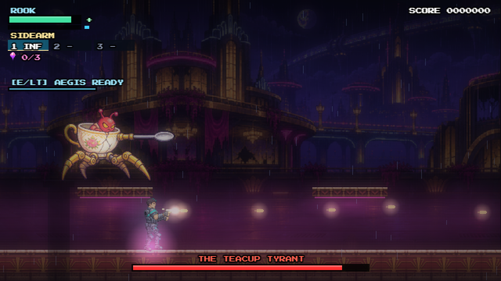
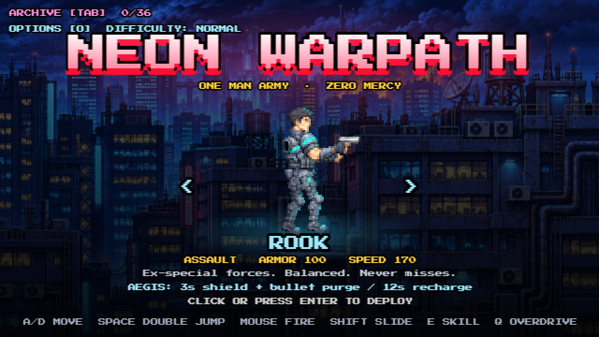

# NEON WARPATH

NEON WARPATH is a side-scrolling pixel-art run-and-gun for desktop browsers. Fight through a city controlled by the rogue AI ARCHON, build your loadout between missions, and make choices that lead to one of three endings.



*Neon Casino boss fight, captured from the browser build.*

[Run it locally](#run-locally) · [Controls](#controls) · [Project status](#project-status) · [Development docs](#development)

## Campaign

- **12 stages and 12 bosses.** Clear combat arenas and adapt to stage hazards such as flooded corridors and moving trains.
- **Five playable operators.** Three are available at the start and two unlock through the story. Each has a rechargeable skill, such as ROOK’s shield or QUILL’s glide.
- **Build a loadout as you go.** Keep your infinite-ammo sidearm, carry two pickup weapons, and choose a perk between missions. Combos and mission grades reward sharper play on repeat runs.
- **Pick up where you left off.** The browser saves checkpoints, briefings, and upgrade picks on the current device. Armor repairs itself after a few seconds without taking damage. Options include three difficulty levels and settings for volume, camera shake, and full-screen flashes.



## Run locally

Install Node.js 22.12 or newer. In a terminal, run:

```sh
git clone https://github.com/akhil-itpro/neon-warpath.git
cd neon-warpath
npm ci
npm run dev
```

Open <http://localhost:5173>. In Windows PowerShell, use `npm.cmd` if script execution blocks `npm`.

To build the game, run `npm run build`. The result goes in `dist/`. Run `npm run preview` to serve the build locally and open the address printed in the terminal.

## Controls

| Action | Keyboard and mouse | Gamepad (Xbox labels) |
| --- | --- | --- |
| Move / crouch | A or D / S | Left stick or D-pad |
| Double jump | Space | A |
| Aim / fire | Mouse + left click, or J with aim assist | Right stick / X or RT |
| Slide | Shift or right click | B or RB |
| Operator skill / Overdrive | E / Q | LT / Y |
| Select or cycle weapon | 1–3 / Tab | D-pad Up to cycle |
| Pause | Esc | Start |

Press **R** on the title screen to continue a saved run. Press **O** on the title or pause screen to open Options.

## Project status

The desktop browser campaign is playable from operator selection through the credits. The latest campaign pass recorded 101 passing automated browser scenarios, plus focused input-driven tests on selected fights. The full human campaign playthrough, physical-controller feel, and audio mix still need playtesting. Boss Rush and online leaderboards are roadmap ideas.

See the [handoff](docs/HANDOFF.md) for verification details and the [roadmap](docs/ROADMAP.md) for remaining work.

## Development

The project uses TypeScript, Phaser 3, and Vite. Stage layouts, enemy definitions, weapons, and story content live in [`src/data/`](src/data). Phaser [scenes](src/scenes) handle the title, briefings, gameplay, HUD, and endings. [Shared systems](src/systems) handle input, saves, audio, and other behavior. The browser loads processed art from [`public/assets/`](public/assets), and the game synthesizes its audio at runtime.

- `npm run check` runs the TypeScript check.
- `npm run smoke` runs the browser smoke suite using Chrome or Edge on Windows and writes captures to `tools/shots/`. Use `npm run smoke -- title` for a quick start-to-game check.
- [Game design](docs/GDD.md), [art pipeline](docs/ART_PIPELINE.md), and [engineering guide](CLAUDE.md) cover the design, asset workflow, and project commands.

## Credits and license

NEON WARPATH is Akhil’s project. Development included assistance from Codex and Claude, and the art workflow includes AI-generated source images. The repository currently has no license file.
